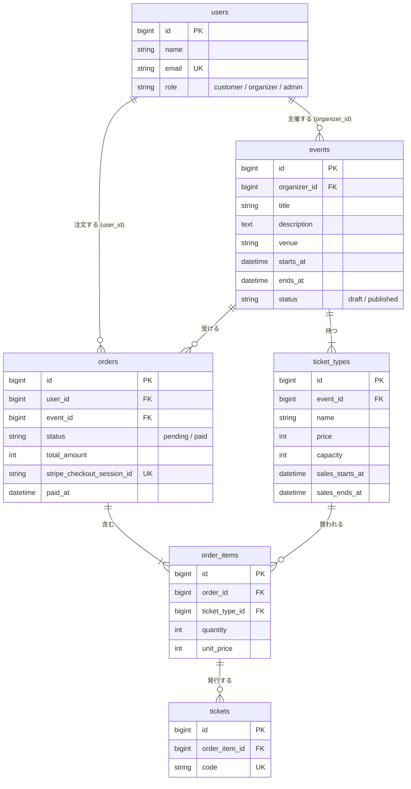

# まちチケ データベース設計

## ER 図



<br>

## テーブル定義

全テーブルに `created_at` / `updated_at`（timestamps）を付ける。下の表では省略する。

### users（既存テーブルに追加）

| カラム | 型 | 制約 | 説明 |
|-|-|-|-|
| role | string(20) | NOT NULL, default `customer` | `customer` / `organizer` / `admin`。Enum（`UserRole`）にキャスト |

### events

| カラム | 型 | 制約 | 説明 |
|-|-|-|-|
| id | bigint | PK | |
| organizer_id | bigint | FK → users.id, restrict | 主催者 |
| title | string(255) | NOT NULL | イベント名 |
| description | text | NOT NULL | 説明 |
| venue | string(255) | NOT NULL | 会場 |
| starts_at | datetime | NOT NULL | 開始日時。一覧の並び順と「開催済み除外」に使う |
| ends_at | datetime | NULL | 終了日時 |
| status | string(20) | NOT NULL, default `draft` | `draft` / `published`。Enum（`EventStatus`）にキャスト |

インデックス: `(status, starts_at)`（公開イベント一覧 C3 用）

### ticket_types

| カラム | 型 | 制約 | 説明 |
|-|-|-|-|
| id | bigint | PK | |
| event_id | bigint | FK → events.id, cascade | イベント削除で券種も消える |
| name | string(100) | NOT NULL | 券種名（一般、学生など） |
| price | unsigned int | NOT NULL | 価格（円、整数）。Stripe に通すため 1 円以上（アプリ側で検証） |
| capacity | unsigned int | NOT NULL | 定員 |
| sales_starts_at | datetime | NOT NULL | 販売開始 |
| sales_ends_at | datetime | NOT NULL | 販売終了。sales_starts_at より後（バリデーション） |

### orders

| カラム | 型 | 制約 | 説明 |
|-|-|-|-|
| id | bigint | PK | |
| user_id | bigint | FK → users.id, restrict | 注文者 |
| event_id | bigint | FK → events.id, restrict | 対象イベント。主催者の売上集計（C16）を単純にするために持つ |
| status | string(20) | NOT NULL, default `pending` | `pending`（支払い待ち） / `paid`（支払い済み）。Enum（`OrderStatus`）にキャスト |
| total_amount | unsigned int | NOT NULL | 合計金額（明細の単価×枚数の合計）。注文時点で確定 |
| stripe_checkout_session_id | string(255) | NULL, UNIQUE | Checkout Session の ID。Day4 時点では NULL、Stripe へ進むときに保存 |
| paid_at | datetime | NULL | 支払い確定日時。Webhook で保存 |

インデックス: `(event_id, status)`（売上集計用）、`user_id`（マイページ用）

### order_items

| カラム | 型 | 制約 | 説明 |
|-|-|-|-|
| id | bigint | PK | |
| order_id | bigint | FK → orders.id, cascade | 明細は注文と一緒に消える |
| ticket_type_id | bigint | FK → ticket_types.id, restrict | 売れた券種は消せない |
| quantity | unsigned smallint | NOT NULL | 枚数（1 以上） |
| unit_price | unsigned int | NOT NULL | 注文時点の単価。券種の価格を後で変えても変わらない |

ユニーク: `(order_id, ticket_type_id)`（同じ注文で同じ券種が2行にならない）

### tickets

| カラム | 型 | 制約 | 説明 |
|-|-|-|-|
| id | bigint | PK | |
| order_item_id | bigint | FK → order_items.id, cascade | 発行元の明細 |
| code | char(26) | NOT NULL, UNIQUE | チケット固有コード。`Str::ulid()` で生成（連番でなく推測されにくい） |

<br>

## 外部キーの削除時の動き

| 外部キー | 動き | 理由 |
|-|-|-|
| events.organizer_id | restrict | 主催者を消すとイベントと売上が消えるため |
| orders.user_id | restrict | 購入履歴と売上の記録を残すため |
| orders.event_id | restrict | 注文があるイベントは削除させない |
| ticket_types.event_id | cascade | 注文がなければ券種ごと消してよい |
| order_items.order_id | cascade | 明細は注文の一部 |
| order_items.ticket_type_id | restrict | 売れた券種を消すと明細の参照先がなくなるため |
| tickets.order_item_id | cascade | チケットは明細の一部 |

注文が1件でもあるイベント・券種は DB の制約で削除できない。アプリ側でも削除前に注文の有無を確認し、「注文があるため削除できません」と表示する。

<br>

## 残り枚数の計算方法

残り枚数はカラムに持たず、注文明細から毎回計算する。カラムに持つと、注文や期限切れのたびに更新が必要になり、ずれやすいため。

### 計算式

```
残り枚数 = 定員（capacity）− 確保済みの枚数
確保済みの枚数 = 次の注文に含まれる、その券種の quantity の合計
  ・status が paid の注文
  ・status が pending で、作成から35分以内の注文
```

- 支払い待ちの注文も枠を押さえる。押さえないと、支払い中に他の人が同じ枠を買えてしまい、定員を超える
- 支払いを途中でやめた注文がいつまでも枠を押さえないよう、pending は35分で数えなくなる
- Stripe Checkout Session の有効期限（`expires_at`）は作成から30分にする（Stripe の最小値）。注文作成から Session 作成までの時間差を見込んで、数える時間は5分長い35分にする。35分を過ぎた pending 注文は、もう支払えない

### 例

定員 50 枚の券種で、次の注文がある場合。

| 注文 | 状態 | 作成からの時間 | 枚数 | 数えるか |
|-|-|-|-:|:-:|
| A | paid | 2日 | 10 | 数える |
| B | pending | 10分 | 3 | 数える |
| C | pending | 1時間 | 5 | 数えない |

残り枚数 = 50 − (10 + 3) = 37 枚

### 実装の目安

`TicketType` モデルにメソッドとして置き、イベント詳細（C4）と注文作成時のチェック（C9）の両方で使う。

```php
public function remainingCount(): int
{
    $reservedCount = $this->orderItems()
        ->whereHas('order', function ($query) {
            $query->where('status', OrderStatus::Paid)
                ->orWhere(function ($query) {
                    $query->where('status', OrderStatus::Pending)
                        ->where('created_at', '>=', now()->subMinutes(35));
                });
        })
        ->sum('quantity');

    return max(0, $this->capacity - $reservedCount);
}
```

### 注文作成時のチェック（C9）

- 販売期間内か（`sales_starts_at <= now() <= sales_ends_at`）
- 注文する枚数が残り枚数以下か
- どちらかを満たさなければ注文を作らず、エラーを表示する

同時に注文が来たときの売り越し対策（トランザクションと行ロック）は拡張モジュール E2 で扱う。コアでは上のチェックだけを行う。

<br>

## 決めておくこと・補足

- アカウント削除: スターターキットの退会機能は、イベントや注文を持つユーザーだと restrict により DB エラーになる。退会画面を隠すか、エラーメッセージを出す
- 1注文 = 1イベント: 1つの注文の明細は、すべて同じイベントの券種にする（アプリ側で保証）
- 拡張モジュールで足すカラム（今は作らない）
  - `events.image_path`（E14）
  - `tickets.checked_in_at`（E1）
  - `orders.status` の `canceled` / `refunded`（E3）
