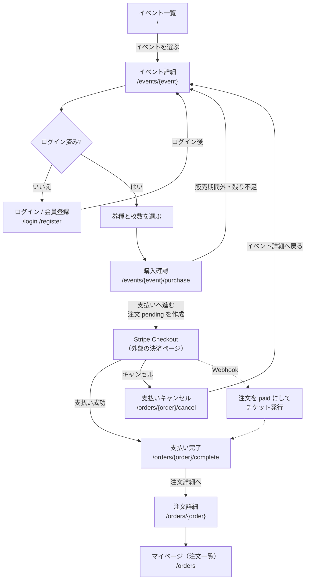

# まちチケ 画面一覧

## Day4（講義中に作る範囲）

| 画面名 | URL | ログインが必要か | 使えるロール | 表示するもの・できること |
|-|-|:-:|-|-|
| 会員登録 | `/register` | 不要 | 誰でも | 名前・メール・パスワードを入力し、「主催者として登録」を選べる（C1）。既存画面にロール選択を追加 |
| ログイン / パスワードリセット | `/login`、`/forgot-password`、`/reset-password/{token}` | 不要 | 誰でも | ログインとパスワードの再設定（C1）。既存画面を日本語化するだけ |
| イベント一覧（トップ） | `/` | 不要 | 誰でも | 公開中で終了していないイベント（開催中も含む）を開催日が近い順に並べる。日時・会場・最安価格を表示（C3） |
| イベント詳細・購入 | `/events/{event}` | 見るだけなら不要。購入は必要 | 誰でも。購入はログインユーザー全員 | 日時・会場・説明・券種（価格・残り枚数・販売期間）。券種と枚数を選んで注文（pending）を作る。売り切れ・期間外はエラー表示。未ログインなら「ログインして購入」（C4, C8, C9）。下書きは主催者本人と管理者以外には 404 |
| 購入確認 | `/events/{event}/purchase` | 必要 | ログインユーザー全員 | イベント詳細で選んだ券種・枚数（セッション `purchase.{event_id}`）と小計・合計を表示し、「支払いへ進む」で注文（pending）を作る。販売期間外・残り不足などはエラー表示（C9）。公開前のイベントは 404 |
| 注文受付（仮） | `/orders/{order}/complete` | 必要 | 注文者・そのイベントの主催者・管理者 | 「注文を受け付けました」と表示するだけの仮画面。平日課題で Stripe Checkout へのリダイレクトに差し替える。他人の注文は 403 |
| 主催者ダッシュボード | `/organizer/events` | 必要 | 主催者 | 自分のイベント一覧（公開状態・開催日）と、新規登録・編集へのリンク（C15） |
| イベント登録 | `/organizer/events/create` | 必要 | 主催者 | タイトル・日時・会場・説明を入力し、下書きで保存する（C5） |
| イベント編集 | `/organizer/events/{event}/edit` | 必要 | 主催者（自分のイベントのみ） | イベントの編集と削除。同じ画面で券種の追加・編集・削除、下書き / 公開の切り替えもする（C5, C6, C7）。他人のイベントは 403 |

## 平日課題

| 画面名 | URL | ログインが必要か | 使えるロール | 表示するもの・できること |
|-|-|:-:|-|-|
| 支払い完了 | `/orders/{order}/complete?session_id=...` | 必要 | 注文者・そのイベントの主催者・管理者 | Stripe Checkout の success_url。支払いを受け付けたことと、注文詳細へのリンクを表示する（C13）。チケットの確定は Webhook が行うので、確定前なら「処理中」と表示する（09 章）。合計 0 円の注文は Stripe を通さず直接ここへ来る |
| 支払いキャンセル | `/orders/{order}/cancel` | 必要 | 注文者のみ（他人は 403） | Stripe Checkout の cancel_url。pending の注文を cancelled にして枠を戻し、イベント詳細へ戻すリンクを出す。支払い済みの注文は変更しない（C13） |
| マイページ（注文一覧） | `/orders` | 必要 | ログインユーザー | 自分の注文をイベント名・日時・金額・状態付きで並べる（C14） |
| 注文詳細 | `/orders/{order}` | 必要 | ログインユーザー（自分の注文のみ） | 注文内容と発行されたチケット一覧。当日見せる画面（C14） |
| 注文一覧・売上 | `/organizer/events/{event}/orders` | 必要 | 主催者（自分のイベントのみ）・管理者 | 支払い済みの注文一覧（購入者・券種・枚数・金額、詳細はモーダル。チケットコードは出さない）、券種別の販売枚数 / 定員と売上、売上合計・販売枚数・注文数（C16）。売上は支払い済みの明細の「単価×枚数」の合計 |

画面ではないもの（平日課題）

- Stripe Webhook（`POST /stripe/webhook`、C11）
- 購入完了メール（C12）

## 画面遷移図（参加者の購入フロー）

イベントを見つけてチケットを買い終わるまでの流れ。点線は画面ではなく裏側の処理。Day4 では「支払いへ進む」の後は仮画面（`/orders/{order}/complete`）に遷移し、平日課題で Stripe Checkout に差し替える。

## 決めておくこと

- Day4 の注文作成後の遷移先: Stripe は平日課題なので、Day4 は注文を作って仮の完了画面（`/orders/{order}/complete`）に「注文を受け付けました」と出すだけにする。平日に Stripe Checkout へのリダイレクトに差し替える
- 既存の `/dashboard`: ログイン後の遷移先として、ロール別に振り分ける（推奨）。主催者は `/organizer/events`、参加者は `/` へ
